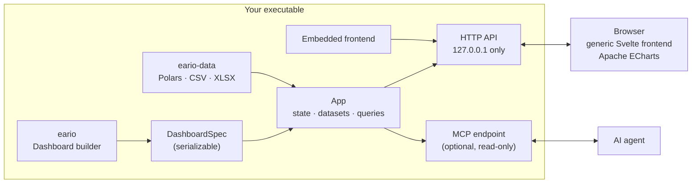

<p align="center">
  <picture>
    <source media="(prefers-color-scheme: dark)" srcset="assets/branding/logo-dark.svg">
    
  </picture>
</p>

<p align="center"><strong>Bring your data to light.</strong></p>

Eario is a local-first Rust framework for building interactive dashboards,
data exploration tools and scientific applications with minimal boilerplate.

You describe a dashboard in Rust. Eario compiles it into a single executable
that starts a local server, opens the browser, and lets the user work with
their own files. Nothing leaves the machine.

> **Status: early foundation (0.1.0, unreleased).** The architecture and one
> complete vertical slice are in place and tested. The API will change. See
> [project status](docs/project-status.md).

## Why

Streamlit and Dash make it quick to put an interface on an analysis, but the
result needs a Python environment and usually a server. Handing a tool to a
colleague who does not program remains hard. Eario aims for the same speed of
development with a different result: one executable, no installation, no
account, data kept local.

## Philosophy

- **Local-first.** No cloud, no account, no internet connection required.
- **Rust-first.** Dashboards are written in Rust only; the frontend is generic.
- **A dashboard is data.** The Rust API builds a serializable specification,
  so dashboards can later be stored, shared, edited or generated.
- **Reuse over reinvention.** Polars for tables, Apache ECharts for charts,
  Axum for the server, the official SDK for MCP.
- **Small and understandable.** Few crates, explicit code, documented decisions.

## Who it is for

Developers and scientists who write Rust and want to give colleagues an
interactive tool for their data, without asking them to install anything.

## A minimal example

```rust
use eario::prelude::*;

fn main() -> eario::Result<()> {
    let data = DatasetId::new("data");
    let x = StateKey::new("x");
    let y = StateKey::new("y");
    let filter = StateKey::new("filter");
    let filtered = DataView::of(&data).filtered_by(&filter);

    Dashboard::new("Data Explorer")
        .page("Explore", |page| {
            page.row([file_import(&data).span(4), dataset_info(&data)])
                .row([
                    numeric_column_select("X axis", &data, &x, 0),
                    numeric_column_select("Y axis", &data, &y, 1),
                    filter_input(&data, &filter).span(6),
                ])
                .row([scatter_chart(filtered.clone(), &x, &y)])
                .row([statistics(filtered.clone())])
        })
        .page("Rows", |page| page.row([data_table(filtered)]))
        .run()
}
```

That is the whole application in [`examples/data-explorer`](examples/data-explorer/src/main.rs).
Changing a column or the filter updates only the components that depend on it.

## Features

Implemented and tested:

- Dashboards defined in Rust, with pages, rows and a 12-column layout.
- Import of CSV, TSV and XLSX files from the browser or at start-up, with
  worksheet selection, type inference and missing values.
- Components: file import, dataset metadata, column selection, row filter,
  paged table, scatter and line charts, descriptive statistics, text, and
  number, slider, text, select and checkbox inputs with server-side
  validation.
- Custom Rust computations: register a named function that turns tables and
  parameters into a table, declare a derived dataset from it, and every
  component reads it like an imported one. Results are cached until an input
  changes; Polars is available as `eario::polars`. State handles are typed
  (`State<T>`). There is no progress reporting or cancellation yet.
- Dependency tracking: a change invalidates only the components reading it.
- Charts by Apache ECharts with zoom, pan and image export; large series are
  downsampled on the backend.
- Light and dark themes following the system, remembered between runs.
- A single executable with the frontend embedded; works offline.
- Loopback-only server with Host and Origin validation and a session token.
- Clear import and validation errors.

Experimental:

- A read-only [MCP](https://modelcontextprotocol.io) endpoint letting an AI
  agent inspect the dashboard and its datasets. It is off unless the
  application enables it (Cargo feature `mcp` and `Dashboard::mcp(true)`).
  What an agent reads may leave your machine, depending on the agent you
  connect. It never runs a computation: a derived dataset is readable once the
  dashboard has displayed it. See [ADR 0009](docs/adr/0009-mcp-integration.md).

Planned, not implemented: more chart types, grouping and joins, saved
sessions, data mining, Python scripts, an AI
assistant, a visual dashboard editor, a desktop shell. See the
[roadmap](docs/roadmap.md).

## Quick start

Eario is not published on crates.io yet. To try it from a checkout you need a
stable [Rust toolchain](https://rustup.rs) and [Node.js](https://nodejs.org)
(developed with version 25; it is only needed to build the frontend from
source).

```text
git clone https://github.com/rtonneau/eario
cd eario
cargo xtask frontend
cargo run -p data-explorer -- fixtures/excel/samples.xlsx
```

The browser opens on the dashboard. Choose **Quit** in the header, or press
Ctrl+C in the terminal, to stop.

To try custom computations, run the `signal-lab` example, which has a
smoothed signal with a histogram and a per-group summary:

```text
cargo run -p signal-lab -- fixtures/csv/time-series.csv fixtures/csv/groups.csv
```

Its source is [`examples/signal-lab`](examples/signal-lab/src/main.rs). The
sample files are written by `cargo xtask fixtures`.

To build a standalone executable:

```text
cargo xtask dist
```

The result is `target/release/data-explorer` (`.exe` on Windows). It needs
nothing else to run.

## Architecture



The frontend knows nothing about a particular dashboard: it renders the
specification it receives and asks the backend for the data of each component.
Details are in the [architecture overview](docs/architecture/overview.md) and
the [decision records](docs/adr/README.md).

## Repository

| Path | Content |
| --- | --- |
| `crates/eario` | Public API: `Dashboard`, widgets, prelude |
| `crates/eario-core` | Dashboard specification and frontend/backend contract |
| `crates/eario-data` | File readers, datasets, tabular queries |
| `crates/eario-runtime` | Application services, local server, embedded frontend |
| `crates/eario-mcp` | MCP server (optional) |
| `frontend/` | Generic Svelte and TypeScript frontend |
| `examples/` | `hello-dashboard`, `data-explorer`, `signal-lab` |
| `fixtures/` | Synthetic test data |
| `docs/` | Architecture, decisions, roadmap, status, development guide |
| `xtask/` | Development commands |

## Development

```text
cargo xtask setup      # install frontend dependencies
cargo xtask check      # format, lints, tests, docs, frontend type check and tests
cargo xtask help       # all commands
```

See the [development guide](docs/development/guide.md).

## Roadmap

Custom Rust computations are done. The next milestones are continuous
verification, standalone and hub operation, and import, chart and
transformation types. The full list is in the
[roadmap](docs/roadmap.md).

## Contributing

Contributions are welcome. Read [CONTRIBUTING.md](CONTRIBUTING.md) first; for
security issues, see [SECURITY.md](SECURITY.md).

## Name

Eario is named after a star of legend whose light was carried into dark
places. The framework hopes to do the same for data.

## License

Licensed under either of

- Apache License, Version 2.0 ([LICENSE-APACHE](LICENSE-APACHE))
- MIT license ([LICENSE-MIT](LICENSE-MIT))

at your option.

Unless you explicitly state otherwise, any contribution intentionally
submitted for inclusion in the work by you, as defined in the Apache-2.0
license, shall be dual licensed as above, without any additional terms or
conditions.
