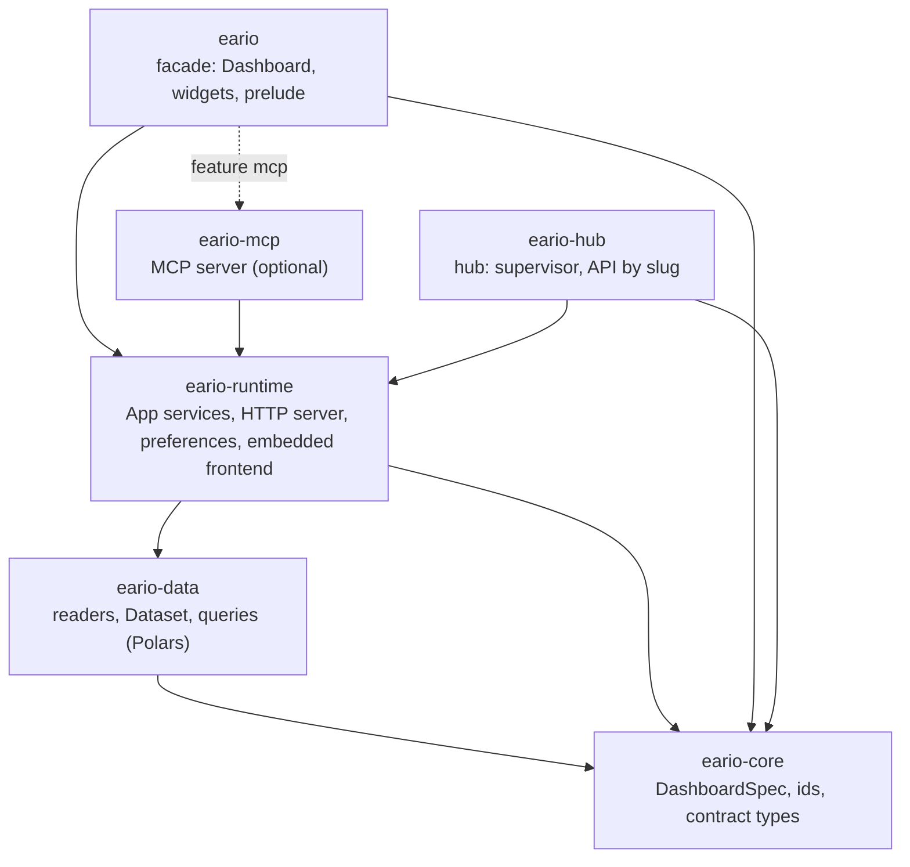
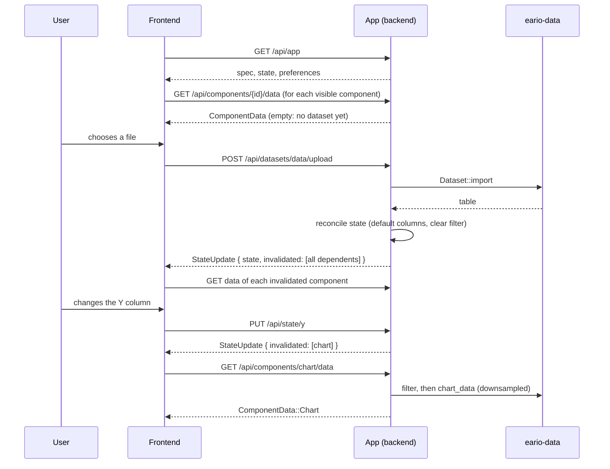
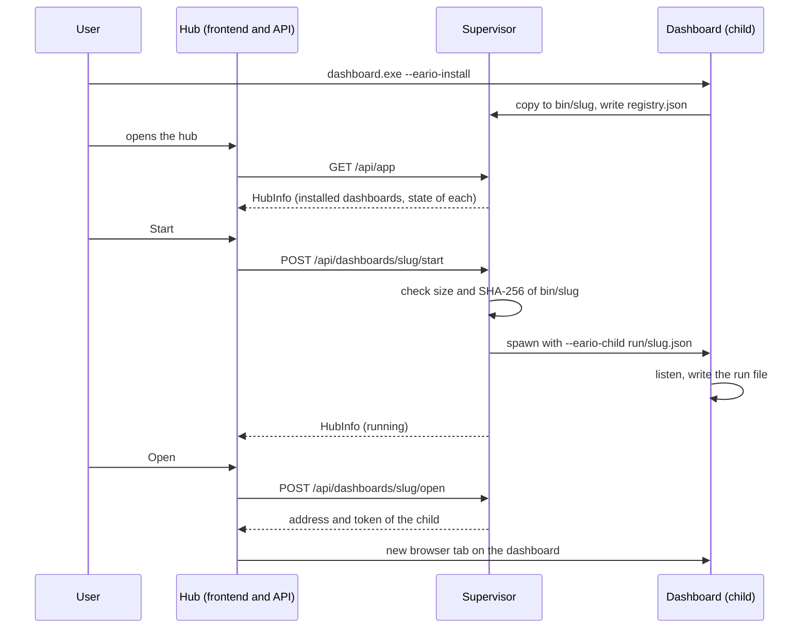

# Architecture overview

This document describes Eario as it is built today. Decisions and their
alternatives are in [`docs/adr/`](../adr/README.md); what is missing is in
[`docs/project-status.md`](../project-status.md).

## The idea in one paragraph

A developer describes a dashboard with a Rust builder. The builder produces a
`DashboardSpec`: plain, serializable data naming the pages, the components,
the datasets they read and the state entries that connect them. At run time
an `App` owns that specification, the loaded datasets and the application
state. A generic frontend fetches the specification, renders it, and asks the
`App` for the data of each component. When the user changes an input, the
`App` updates the state and answers with the list of components whose data is
now stale; the frontend fetches those again and nothing else.

## Crates



| Crate | Responsibility | Main dependencies |
| --- | --- | --- |
| `eario-core` | The vocabulary: specification, identifiers, filter, payloads, API envelopes. | serde |
| `eario-data` | `TableReader` interface and its CSV, TSV, XLSX implementations; `Dataset`; filtering, paging, chart preparation, statistics; `Computation`, `ComputeContext` and the registry; the `polars` re-export. | polars, calamine |
| `eario-runtime` | `App` (the application services, evaluation and cache of derived datasets), the Axum server and its security layer, user preferences, the embedded frontend. | axum, tokio, rust-embed |
| `eario-mcp` | MCP tools over `App`, served on `/mcp`. | rmcp |
| `eario-hub` | The hub: `Supervisor` (list, start, open, stop, uninstall installed dashboards), its HTTP API, and the `eario-hub` executable. No crate depends on it. | eario-runtime, axum |
| `eario` | What a dashboard author imports: `Dashboard`, `Page`, `State<T>`, widget constructors, `run()`, and `eario::polars`. | the crates above |

Crates named in the initial plan but not created, because nothing needs them
yet:

| Planned crate | Created when |
| --- | --- |
| `eario-analysis` | The first analysis beyond descriptive statistics is added (regression, PCA, ...). |
| `eario-charts` | A second chart builder or a server-side renderer appears. Chart types live in `eario-core`, preparation in `eario-data::query`. |
| `eario-widgets` | Widgets outgrow `eario::widgets`, or third parties need to define them. |
| `eario-persistence` | Sessions are saved. Preferences live in `eario-runtime::preferences`. |
| `eario-agent` | An agent provider is integrated (ADR 0008). |
| `eario-cli` | Project scaffolding is wanted. `xtask` covers development commands. |
| `extensions/python`, `extensions/scientific` | See ADR 0007 and the roadmap. |

## The dashboard specification

Defined in `eario-core::spec`.

```text
DashboardSpec
├── spec_version
├── title
├── datasets: [DatasetSlot { id, label,
│       source: Imported | Computed { function, inputs, params } }]
└── pages: [PageSpec { id, title,
        rows: [RowSpec { items: [ComponentSpec { id, title, span, kind }] }] }]
```

`ComponentKind` is a tagged enum. Each variant carries only references:

| Kind | Reads | Writes |
| --- | --- | --- |
| `text` | nothing | |
| `file_import` | dataset | (replaces the dataset through the API) |
| `dataset_info` | dataset | |
| `column_select` | dataset | one state entry: a column name |
| `filter_input` | dataset | one state entry: a `Filter` |
| `number_input`, `slider` | nothing | one state entry: a number, within the bounds, step and integrality of the input |
| `text_input` | nothing | one state entry: text, at most `max_length` characters |
| `select` | a dataset, when its options come from a column | one state entry: one of the options |
| `checkbox` | nothing | one state entry: a boolean |
| `data_table` | a `DataView` | |
| `chart` | a `DataView`, two state entries (x and y columns) | |
| `statistics` | a `DataView` | |

A `DataView` is a dataset plus an optional state entry holding a filter.

### Computations and derived datasets

A `DatasetSlot` has a `source`. `Imported` (the default, and the only choice
in specification version 1) is filled from a file. `Computed` names a
computation and binds what it reads:

- `function`: the name of a computation registered by the developer.
- `inputs`: the datasets it reads, by the name the computation knows them
  under. Each is a `DataView`, so an input can be filtered.
- `params`: its parameters, by name. A `ParamBinding` is either `State(key)`,
  the current value of a state entry, or `Literal(value)`, a constant.

The specification holds only these names and values. The function itself is a
`Computation` (`eario-data::compute`): a name, the input and parameter names
it declares, and a closure `Fn(&ComputeContext) -> Result<DataFrame,
ComputeError>`. The author registers it with `Dashboard::computation`. Inside
the closure `ctx.input("name")` gives a table, and `ctx.param::<T>("name")`
or `ctx.param(&state)` a typed parameter. A parameter whose state is still
`null` gives the component an empty answer that says which input to set,
not an error.

`validate()` checks what needs no registry: bindings point to declared slots
and to state entries that have a writer, derived datasets form no cycle, and
no `file_import` targets a derived slot. `App::new` checks the rest against
the registry: the computation exists, and every input and parameter it
declares is bound, with none undeclared.

`ComponentKind::dependencies()` and `DashboardSpec::dataset_dependencies()`
follow derived datasets down to the imported datasets and state entries they
read, so a component over a derived dataset is invalidated when any of them
changes.

`ComponentKind::dependencies()` returns what a component reads. This is the
whole reactive model: there is no dependency graph object, because the
specification already is one. `DashboardSpec::validate()` rejects dangling
references, duplicate identifiers and state entries with zero or several
writers, so the rest of the system can assume a consistent specification.

How the concerns of the specification are separated:

| Concern | Where it lives |
| --- | --- |
| Structure | `DashboardSpec`, `PageSpec` |
| Layout | `RowSpec`, `ComponentSpec::span` |
| Component definitions | `ComponentKind` |
| Data references | `DatasetId`, `DataView` |
| User interaction | state entries (`StateKey`) written by input components |
| Analysis dependencies | `ComponentKind::dependencies()` |
| Runtime behaviour | `eario-runtime::App`, not in the specification |
| Presentation | the frontend (`frontend/src`), not in the specification |

## Data flow



The backend is authoritative: state lives in `App`, not in the browser. A
reloaded tab, a second tab and an MCP agent all see the same session.

### Where the work happens

- All computation is on the backend. The frontend formats and draws.
- `App` methods are synchronous. The HTTP and MCP adapters call them through
  `tokio::task::spawn_blocking`, so parsing and Polars never block the async
  runtime. Polars parallelizes internally with Rayon.
- The session lock is held only to read or swap references. A query clones the
  `DataFrame` handle (shared columns, no data copy), releases the lock, then
  computes.
- The imported table is never modified. A filter produces a new table that
  shares nothing mutable with the original. A computation receives its input
  tables by reference and returns a new one.
- A chart never receives more than `max_points` points (default 5000); a table
  receives one page.

### Evaluation and cache of derived datasets

A derived dataset is computed lazily, when a component, a column list or an
input asks for its table (`resolve_view`):

1. The inputs are resolved first, recursively, so a derived dataset can read
   another one.
2. `Session` keeps a revision per imported dataset and per state entry. The
   cache key of a derived slot is the revisions of everything it depends on,
   directly or through other derived datasets. One entry is kept per slot:
   the latest result. A matching entry is returned without running the
   function.
3. On a miss, the session lock is released, then the function runs on the
   thread the adapter already provides (`spawn_blocking`). Panics are caught
   (`catch_unwind`). Two readers that need the same slot share one run.
4. If a dependency changed while the function ran, the result is returned to
   that caller but not cached.
5. An error or panic becomes `AppError::Computation { name, message }`
   (HTTP 422, shown by the frontend as an alert naming the computation). It
   caches nothing and leaves the application usable.

Importing, loading or selecting a worksheet for a derived slot is refused
(`derived_dataset`, 409). `App::datasets()` describes a derived slot as
`computed` or `not_computed`.

### Reconciliation

Inputs that depend on a table keep their state valid: after an import, a
column select falls back to a column that exists, and a select offering the
distinct values of a column (at most 1,000, with a `truncated` flag) falls
back to a value still on offer. This is reconciliation. It also applies when
the table is a derived one, whose columns change when its parameters change.
So a derived dataset that has inputs bound to it is recomputed during the
change itself rather than lazily, to reconcile them. Derived datasets are
refreshed in an order that puts a dataset after those whose bound inputs
write a state it reads, so each is recomputed at most once per change. A
reconciliation that changes state gets its own revision, and the
`StateUpdate` reports the final state. `App::new` rejects a `select` that
offers the values of a dataset reading the state that select writes.

### MCP reads the cache only

`App` has cached-only twins of its read methods (`cached_dataset_frame`,
`cached_component_data`), and the MCP tools use only these. A derived dataset
with no current cached table gives `dataset_not_computed` (409), or an empty
component saying "Not computed yet", and the computation is not run
([ADR 0009](../adr/0009-mcp-integration.md)).

### Not built yet

There is no background task, no progress reporting and no cancellation. For
the sizes targeted now (up to a few million rows) filtering takes
milliseconds, so this was deferred deliberately. Imported tables and filtered
views are recomputed at each query; only derived datasets are cached. The
path to those capabilities is described in
[ADR 0002](../adr/0002-backend-frontend-separation.md).

## HTTP API

All routes are under `/api` and require the session token (see
[security.md](security.md)). Bodies are JSON unless noted. The types are
those of `eario-core`.

| Method and path | Body | Answer |
| --- | --- | --- |
| `GET /api/app` | | `AppResponse`: the `AppInfo` of a dashboard with `"kind": "dashboard"`, or a hub's `HubInfo` with `"kind": "hub"` |
| `PUT /api/state/{key}` | a JSON value | `StateUpdate` |
| `GET /api/components/{id}/data?offset=N` | | `ComponentData` |
| `POST /api/datasets/{id}/upload?filename=F` | the raw file | `StateUpdate` |
| `PUT /api/datasets/{id}/sheet` | `{ "sheet": "name" }` | `StateUpdate` |
| `PUT /api/preferences` | `Preferences` | `Preferences` |
| `POST /api/shutdown` | | 204 |

Errors are `ApiError { code, message }` with a 4xx or 5xx status. `code` is
stable and machine-readable; `message` is written for the user.

Everything else is served from the embedded frontend. Paths without a file
extension receive `index.html`.

When the `mcp` feature is enabled and the application opts in, `/mcp` serves
the MCP Streamable HTTP transport behind the same checks (ADR 0009).

## Launch contract and the hub

Every executable built with `Dashboard::run()` also understands a few
arguments that start with `--eario-` (ADR 0011), without code from its author.
With none of them it behaves as before: standalone, opens the browser.

| Argument | Effect |
| --- | --- |
| `--eario-manifest` | Prints the `Manifest` (name, slug, version, Eario and launch protocol versions, description) as JSON and exits. |
| `--eario-install [--yes]` | Copies the executable into `<hub dir>/bin/<slug>/` and records it in `registry.json` with its size and SHA-256, after a confirmation in the terminal that `--yes` skips. Refused while that dashboard runs. |
| `--eario-uninstall [--yes]` | Removes that copy and its entry. |
| `--eario-child <run-file>` | Child mode, used by the hub: no browser, no signal handler, no console window, logs to `logs/<slug>.log`. Once listening it writes the `RunFile` (process id, address, token), and removes it on stop. |

The hub directory is the one named by `EARIO_HUB_DIR`, otherwise `hub` in
Eario's configuration directory (`directories::ProjectDirs`: on Windows
`%APPDATA%\eario\config\hub`, on Linux `~/.config/eario/hub`).

```text
hub/
├── registry.json     installed dashboards: slug, path, size, SHA-256, manifest
├── hub.json          address and token of the running hub (one hub per user)
├── bin/<slug>/       the hub's copy of each installed executable
├── run/<slug>.json   one per running dashboard, written by the dashboard
└── logs/<slug>.log   output of each dashboard
```

`eario-hub` is a separate executable, a terminal process that prints its
address and opens the browser. It serves the same generic frontend, which
shows the hub view because `GET /api/app` answers `"kind": "hub"`. A
`Supervisor` holds the services; the HTTP routes are thin adapters over it.



A dashboard is running when `GET /api/app` at the address of its run file
answers with the token of that file; the process id is not consulted. Quitting
the hub leaves dashboards running. A new hub keeps the run files that answer
and deletes the others.

Hub routes, under `/api`, behind the same Host and Origin checks and session
token as a dashboard. The only handle they accept is the slug of an installed
dashboard: no route takes a path, a command or arguments.

| Method and path | Answer |
| --- | --- |
| `GET /api/app` | `AppResponse` with `"kind": "hub"`: `HubInfo`, the installed dashboards with their state (starting, running, stopped, failed with log lines) |
| `POST /api/dashboards/{slug}/start` | `HubInfo` |
| `POST /api/dashboards/{slug}/stop` | `HubInfo` |
| `POST /api/dashboards/{slug}/open` | `HubOpen`: the address with its token, to open in a new tab |
| `POST /api/dashboards/{slug}/uninstall` | `HubInfo`; refused while it runs |
| `POST /api/stop-all` | `HubInfo` |
| `GET /api/alive` | 204; lets a second hub find the first |
| `POST /api/shutdown` | 204; quits the hub only |

Installing is not an API route: it is the dashboard's own `--eario-install`.
There is no tray yet (ADR 0011, amendment). The security consequences are in
[security.md](security.md).

## Frontend

`frontend/` is a Svelte 5 and TypeScript application built by Vite into
`crates/eario-runtime/frontend-dist`, which `rust-embed` embeds in release
builds.

```text
frontend/src
├── main.ts, App.svelte         entry point, page switching, theme attribute
├── app.css                     design tokens (light-dark()), base styles
└── lib
    ├── generated/              TypeScript types generated from eario-core
    ├── api.ts                  the only module calling fetch
    ├── session.svelte.ts       mirror of backend state, invalidation, notifications
    ├── registry.ts             ComponentKind type → Svelte component
    ├── chart-option.ts         ChartData → ECharts option (the only ECharts-aware module)
    ├── format.ts               number and size formatting
    └── components/             one component per kind, plus Header, Notifications, ...
```

`App.svelte` shows `HubView.svelte` instead of the pages when `/api/app`
reports a hub; it renders `HubInfo` and calls the hub routes through
`api.ts`. A dashboard component receives its `ComponentSpec`, calls `componentData(id)` and
renders what comes back. The registry is typed by `ComponentKind['type']`, so
a kind without a renderer is a compile error.

The frontend contains no logic about a particular dashboard. Building a new
dashboard never requires touching or rebuilding it.

## Persistence

Only user preferences (the theme) are stored, in
`<config dir>/eario/<application-slug>/preferences.json`, written atomically.
Sessions are not saved yet; see [ADR 0006](../adr/0006-persistence.md).

## Execution

`Dashboard::run()` builds the `App`, starts the server on `127.0.0.1` with a
port chosen by the system, prints the address, opens the default browser and
blocks until the user quits from the interface or presses Ctrl+C.

`Dashboard::build()` followed by `eario::runtime::start()` does the same
without opening a browser or installing a signal handler. That split is what
keeps a future desktop shell possible: the application logic does not know
how its window is opened. See [ADR 0010](../adr/0010-deployment.md).
