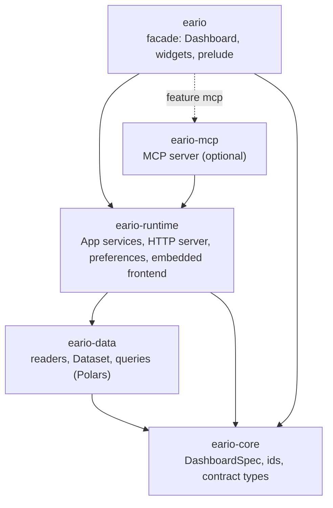
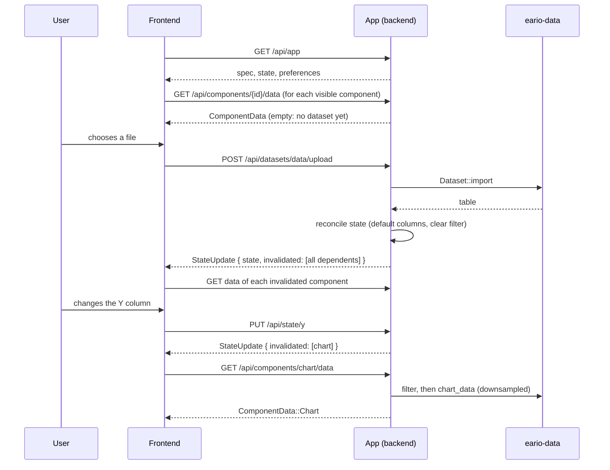

# Architecture overview

This document describes Eario as it is built today. Decisions and their
alternatives are in [`docs/adr/`](../adr/README.md); what is missing is in
[`docs/project-status.md`](../project-status.md).

## The idea in one paragraph

A developer describes a dashboard with a Rust builder. The builder produces a
`DashboardSpec`: plain, serializable data naming the pages, the components,
the datasets they read and the state entries that connect them. At run time
an `App` owns that specification, the loaded datasets and the application
state. A generic frontend fetches the specification, renders it, and asks the
`App` for the data of each component. When the user changes an input, the
`App` updates the state and answers with the list of components whose data is
now stale; the frontend fetches those again and nothing else.

## Crates



| Crate | Responsibility | Main dependencies |
| --- | --- | --- |
| `eario-core` | The vocabulary: specification, identifiers, filter, payloads, API envelopes. | serde |
| `eario-data` | `TableReader` interface and its CSV, TSV, XLSX implementations; `Dataset`; filtering, paging, chart preparation, statistics. | polars, calamine |
| `eario-runtime` | `App` (the application services), the Axum server and its security layer, user preferences, the embedded frontend. | axum, tokio, rust-embed |
| `eario-mcp` | MCP tools over `App`, served on `/mcp`. | rmcp |
| `eario` | What a dashboard author imports: `Dashboard`, `Page`, widget constructors, `run()`. | the crates above |

Crates named in the initial plan but not created, because nothing needs them
yet:

| Planned crate | Created when |
| --- | --- |
| `eario-analysis` | The first analysis beyond descriptive statistics is added (regression, PCA, ...). |
| `eario-charts` | A second chart builder or a server-side renderer appears. Chart types live in `eario-core`, preparation in `eario-data::query`. |
| `eario-widgets` | Widgets outgrow `eario::widgets`, or third parties need to define them. |
| `eario-persistence` | Sessions are saved. Preferences live in `eario-runtime::preferences`. |
| `eario-agent` | An agent provider is integrated (ADR 0008). |
| `eario-cli` | Project scaffolding is wanted. `xtask` covers development commands. |
| `extensions/python`, `extensions/scientific` | See ADR 0007 and the roadmap. |

## The dashboard specification

Defined in `eario-core::spec`.

```text
DashboardSpec
├── spec_version
├── title
├── datasets: [DatasetSlot { id, label }]
└── pages: [PageSpec { id, title,
        rows: [RowSpec { items: [ComponentSpec { id, title, span, kind }] }] }]
```

`ComponentKind` is a tagged enum. Each variant carries only references:

| Kind | Reads | Writes |
| --- | --- | --- |
| `text` | nothing | |
| `file_import` | dataset | (replaces the dataset through the API) |
| `dataset_info` | dataset | |
| `column_select` | dataset | one state entry: a column name |
| `filter_input` | dataset | one state entry: a `Filter` |
| `data_table` | a `DataView` | |
| `chart` | a `DataView`, two state entries (x and y columns) | |
| `statistics` | a `DataView` | |

A `DataView` is a dataset plus an optional state entry holding a filter.

`ComponentKind::dependencies()` returns what a component reads. This is the
whole reactive model: there is no dependency graph object, because the
specification already is one. `DashboardSpec::validate()` rejects dangling
references, duplicate identifiers and state entries with zero or several
writers, so the rest of the system can assume a consistent specification.

How the concerns of the specification are separated:

| Concern | Where it lives |
| --- | --- |
| Structure | `DashboardSpec`, `PageSpec` |
| Layout | `RowSpec`, `ComponentSpec::span` |
| Component definitions | `ComponentKind` |
| Data references | `DatasetId`, `DataView` |
| User interaction | state entries (`StateKey`) written by input components |
| Analysis dependencies | `ComponentKind::dependencies()` |
| Runtime behaviour | `eario-runtime::App`, not in the specification |
| Presentation | the frontend (`frontend/src`), not in the specification |

## Data flow



The backend is authoritative: state lives in `App`, not in the browser. A
reloaded tab, a second tab and an MCP agent all see the same session.

### Where the work happens

- All computation is on the backend. The frontend formats and draws.
- `App` methods are synchronous. The HTTP and MCP adapters call them through
  `tokio::task::spawn_blocking`, so parsing and Polars never block the async
  runtime. Polars parallelizes internally with Rayon.
- The session lock is held only to read or swap references. A query clones the
  `DataFrame` handle (shared columns, no data copy), releases the lock, then
  computes.
- The imported table is never modified. A filter produces a new table that
  shares nothing mutable with the original.
- A chart never receives more than `max_points` points (default 5000); a table
  receives one page.

### Not built yet

Each query recomputes from the original table: there is no cache of
intermediate results, no background task, no progress reporting and no
cancellation. For the sizes targeted now (up to a few million rows) filtering
takes milliseconds, so this was deferred deliberately. The path to those
capabilities is described in [ADR 0002](../adr/0002-backend-frontend-separation.md).

## HTTP API

All routes are under `/api` and require the session token (see
[security.md](security.md)). Bodies are JSON unless noted. The types are
those of `eario-core`.

| Method and path | Body | Answer |
| --- | --- | --- |
| `GET /api/app` | | `AppInfo` |
| `PUT /api/state/{key}` | a JSON value | `StateUpdate` |
| `GET /api/components/{id}/data?offset=N` | | `ComponentData` |
| `POST /api/datasets/{id}/upload?filename=F` | the raw file | `StateUpdate` |
| `PUT /api/datasets/{id}/sheet` | `{ "sheet": "name" }` | `StateUpdate` |
| `PUT /api/preferences` | `Preferences` | `Preferences` |
| `POST /api/shutdown` | | 204 |

Errors are `ApiError { code, message }` with a 4xx or 5xx status. `code` is
stable and machine-readable; `message` is written for the user.

Everything else is served from the embedded frontend. Paths without a file
extension receive `index.html`.

When the `mcp` feature is enabled and the application opts in, `/mcp` serves
the MCP Streamable HTTP transport behind the same checks (ADR 0009).

## Frontend

`frontend/` is a Svelte 5 and TypeScript application built by Vite into
`crates/eario-runtime/frontend-dist`, which `rust-embed` embeds in release
builds.

```text
frontend/src
├── main.ts, App.svelte         entry point, page switching, theme attribute
├── app.css                     design tokens (light-dark()), base styles
└── lib
    ├── generated/              TypeScript types generated from eario-core
    ├── api.ts                  the only module calling fetch
    ├── session.svelte.ts       mirror of backend state, invalidation, notifications
    ├── registry.ts             ComponentKind type → Svelte component
    ├── chart-option.ts         ChartData → ECharts option (the only ECharts-aware module)
    ├── format.ts               number and size formatting
    └── components/             one component per kind, plus Header, Notifications, ...
```

A component receives its `ComponentSpec`, calls `componentData(id)` and
renders what comes back. The registry is typed by `ComponentKind['type']`, so
a kind without a renderer is a compile error.

The frontend contains no logic about a particular dashboard. Building a new
dashboard never requires touching or rebuilding it.

## Persistence

Only user preferences (the theme) are stored, in
`<config dir>/eario/<application-slug>/preferences.json`, written atomically.
Sessions are not saved yet; see [ADR 0006](../adr/0006-persistence.md).

## Execution

`Dashboard::run()` builds the `App`, starts the server on `127.0.0.1` with a
port chosen by the system, prints the address, opens the default browser and
blocks until the user quits from the interface or presses Ctrl+C.

`Dashboard::build()` followed by `eario::runtime::start()` does the same
without opening a browser or installing a signal handler. That split is what
keeps a future desktop shell possible: the application logic does not know
how its window is opened. See [ADR 0010](../adr/0010-deployment.md).
